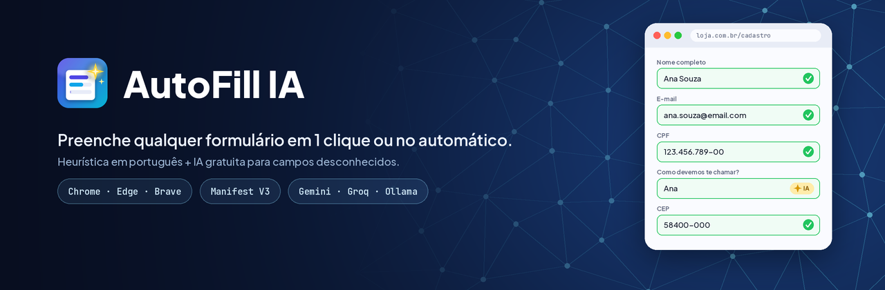

<p align="center"></p>

# AutoFill IA

Extensão para Chrome, Edge e Brave.

Identifica automaticamente os campos de qualquer formulário e preenche com seus dados: em 1 clique ou 100% automático. Quando o campo é “estranho” (nome aleatório, rótulo diferente), usa uma IA gratuita para descobrir o que ele pede.

## Instalar (modo desenvolvedor)
1. Descompacte o zip.
2. Abra `chrome://extensions` (no Edge: `edge://extensions`).
3. Ative **Modo do desenvolvedor**.
4. Clique em **Carregar sem compactação** e escolha a pasta `autofill-ia`.
5. A página de configurações abre sozinha: cadastre seus dados e clique em **Salvar**.

## Modos
| Modo | Como funciona |
|---|---|
| **1 clique** (padrão) | Ao focar um campo reconhecido aparece o botão “⚡ Preencher” |
| **Automático** | Preenche sozinho quando o formulário aparece, inclusive em sites React/SPA |
| **Manual** | Só pelo ícone da extensão ou pelo atalho **Alt+Shift+F** |

## Como identifica os campos
1. **Atributo `autocomplete`** do HTML (quando o site usa o padrão).
2. **Heurística PT/EN**: lê o rótulo (`<label>`), `aria-label`, placeholder, `name`, `id` e o texto próximo, sem acentos. Reconhece “Nome completo”, “Seu melhor e-mail”, “WhatsApp”, “cpf_titular”, “logradouro”, “UF” e afins. Também ignora armadilhas como “Estado civil” e “Nome da mãe”.
3. **IA (opcional)** para o que sobrar. Só os *metadados* do campo (rótulo, name, placeholder) são enviados, **nunca seus dados**. A resposta fica em cache por site, então cada formulário consulta a IA uma única vez.

A extensão nunca toca em senha, cartão, CVV, captcha, código de verificação ou busca.

## IAs gratuitas suportadas
| Provedor | Chave | Observação |
|---|---|---|
| Google Gemini | [aistudio.google.com/apikey](https://aistudio.google.com/apikey) | camada gratuita generosa, recomendado |
| Groq | [console.groq.com/keys](https://console.groq.com/keys) | muito rápido |
| OpenRouter | [openrouter.ai/keys](https://openrouter.ai/keys) | use modelos terminados em `:free` |
| Ollama (local) | não precisa | offline e privado: `ollama pull llama3.2` e depois `OLLAMA_ORIGINS="chrome-extension://*" ollama serve` |

Se o nome do modelo padrão sair de linha, basta digitar outro no campo **Modelo**.

## Detalhes úteis
- Funciona com React, Vue e Angular, porque usa o setter nativo e dispara os eventos `input` e `change`.
- Data `dd/mm/aaaa` é convertida automaticamente para campos `type="date"`.
- Selects de UF, país e gênero aceitam sigla ou nome (PB ou Paraíba).
- Se você só preencher o nome completo, ele é dividido em nome e sobrenome quando o site pede separado.
- No popup há **Ignorar este site** (ex: banco) e **Reaprender campos** (apaga o cache do site).

## Estrutura
```
manifest.json   Manifest V3
fields.js       definição dos campos + regras PT/EN
content.js      detecção, preenchimento, botão flutuante, modo automático
background.js   chamadas à IA (Gemini / Groq / OpenRouter / Ollama) e atalho
popup.*         ações rápidas
options.*       seus dados, modo, IA, sites ignorados
```
